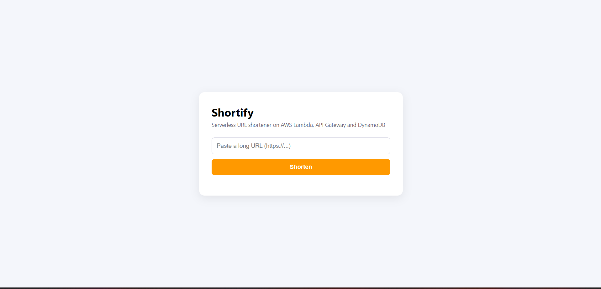
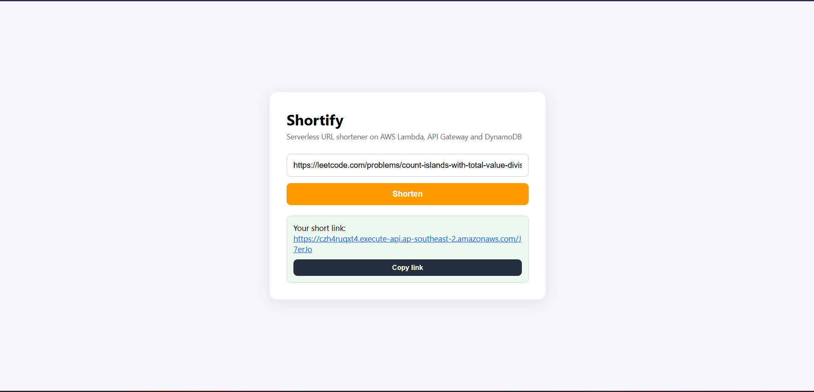

# Shortify - Serverless URL Shortener on AWS

A fully serverless URL shortener built for the **AWS SBG Society** development project. Paste a long link, get a short one, and every visit to the short link is redirected and counted. There are no servers to manage: the backend runs on AWS Lambda, API Gateway and DynamoDB, and the frontend is a static page hosted on Amazon S3.

**Live demo:** `http://shortenurlsfrfr.s3-website-ap-southeast-2.amazonaws.com`
**Built by:** Saksham Bhatnagar, First Year



---

## Features

- Shorten any `http://` or `https://` URL into a 6-character code
- Instant redirect (HTTP 302) from the short link to the original URL
- Click counter for every short link, updated with an atomic DynamoDB operation
- Input validation with clear error messages (400 for bad URLs, 404 for unknown codes)
- Responsive, modern UI with a copy-to-clipboard button and a light/dark pull-cord toggle
- Pay-per-request architecture, so it costs almost nothing when idle

---


| Service | Role |
|---|---|
| **Amazon S3** | Hosts the static frontend (`index.html`) |
| **Amazon API Gateway (HTTP API)** | Public HTTPS endpoint that routes requests to Lambda and handles CORS |
| **AWS Lambda (Python 3.12)** | Business logic: validate URL, generate code, store and look up links, count clicks |
| **Amazon DynamoDB** | Stores `code -> url` and the click count, in on-demand capacity mode |
| **AWS IAM** | Gives the Lambda role only the DynamoDB permissions it needs |

### How it works

**Creating a short link**
1. The browser sends `POST /shorten` with `{"url": "https://..."}`.
2. API Gateway triggers the Lambda function.
3. Lambda validates the URL, generates a random 6-character code, and saves `{code, url, clicks: 0}` in DynamoDB.
4. Lambda returns `{"code": "...", "short_url": "..."}`.

**Opening a short link**
1. A visitor opens `GET /{code}`.
2. Lambda looks up the code in DynamoDB.
3. It increments the `clicks` counter and returns a `302` redirect with the original URL in the `Location` header.

---

## API Reference

Base URL: `https://YOUR-API-ID.execute-api.ap-southeast-2.amazonaws.com`

### `POST /shorten`

Request body:
```json
{ "url": "https://aws.amazon.com" }
```

Success response (`200`):
```json
{ "code": "aB3xK9", "short_url": "https://YOUR-API-ID.execute-api.ap-southeast-2.amazonaws.com/aB3xK9" }
```

Error response (`400`):
```json
{ "error": "Provide a valid http(s) URL" }
```

### `GET /{code}`

| Result | Response |
|---|---|
| Code exists | `302` redirect to the original URL |
| Code not found | `404` with `{ "error": "Not found" }` |

Example:
```bash
curl -X POST https://YOUR-API-ID.execute-api.ap-southeast-2.amazonaws.com/shorten \
  -H "Content-Type: application/json" \
  -d '{"url":"https://aws.amazon.com"}'
```

---

## Data Model

DynamoDB table **`urls`** (partition key: `code`, type String, on-demand capacity)

| Attribute | Type | Description |
|---|---|---|
| `code` | String (PK) | The 6-character short code |
| `url` | String | The original long URL |
| `clicks` | Number | How many times the short link was opened |

---


## Screenshots

| Home page | Short link created |
|---|---|
|  |  |


---

## Design Decisions and Security Notes

- **Serverless:** no servers to patch, automatic scaling, and billing only for requests.
- **Atomic click counter:** `UpdateItem` with `ADD` is safe even when many people click at once.
- **Least privilege (recommended):** the Lambda role should allow only three DynamoDB actions on one table instead of full DynamoDB access.
- **Known limitations:** the API has no authentication or rate limiting, and the S3 website endpoint serves HTTP only.

---


## What I Learned

- How API Gateway, Lambda and DynamoDB work together in a serverless request flow
- Writing IAM permissions and applying least privilege
- Debugging CORS and reading CloudWatch logs
- Hosting a static site on S3 and publishing a project to GitHub

---

## Author

Saksham Bhatnagar - First Year
GitHub: [@sakshambhatnagarrr](https://github.com/sakshambhatnagarrr)
